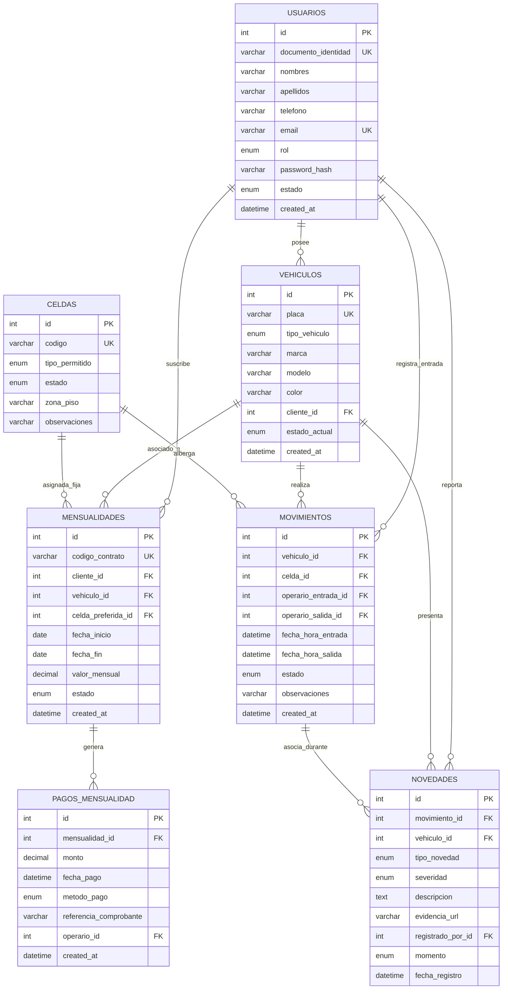

# Modelado de Datos - Parqueadero Autos Colombia (Iteración 1)

Este documento detalla el diseño de la capa de persistencia para el sistema, adaptado específicamente al motor de base de datos **MySQL 8.x**. Incluye el Modelo Entidad-Relación (MER), el Modelo Relacional (MR) normalizado en Tercera Forma Normal (3FN), el diccionario de datos y las consideraciones de integridad.

---

## 1. Modelo Entidad-Relación (MER)

A continuación se presenta el diagrama Entidad-Relación mediante notación Mermaid (Crow's Foot):

---

## 2. Modelo Relacional (MR) Normalizado (3FN)

A continuación se listan las relaciones en formato esquemático formal, destacando Llaves Primarias (**PK**), Llaves Foráneas (**FK**) y Claves Únicas (**UK**):

1. **`usuarios`** (  
   **id** [PK],  
   documento_identidad [UK],  
   nombres, apellidos, telefono, email [UK],  
   rol, password_hash, estado, created_at, updated_at  
)

2. **`vehiculos`** (  
   **id** [PK],  
   placa [UK],  
   tipo_vehiculo, marca, modelo, color,  
   **cliente_id** [FK -> usuarios.id],  
   estado_actual, created_at, updated_at  
)

3. **`celdas`** (  
   **id** [PK],  
   codigo [UK],  
   tipo_permitido, estado, zona_piso, observaciones, created_at, updated_at  
)

4. **`mensualidades`** (  
   **id** [PK],  
   codigo_contrato [UK],  
   **cliente_id** [FK -> usuarios.id],  
   **vehiculo_id** [FK -> vehiculos.id],  
   **celda_preferida_id** [FK -> celdas.id, NULLable],  
   fecha_inicio, fecha_fin, valor_mensual, estado, observaciones, created_at, updated_at  
)

5. **`pagos_mensualidad`** (  
   **id** [PK],  
   **mensualidad_id** [FK -> mensualidades.id],  
   monto, fecha_pago, metodo_pago, referencia_comprobante,  
   **operario_id** [FK -> usuarios.id],  
   created_at  
)

6. **`movimientos`** (  
   **id** [PK],  
   **vehiculo_id** [FK -> vehiculos.id],  
   **celda_id** [FK -> celdas.id],  
   **operario_entrada_id** [FK -> usuarios.id],  
   **operario_salida_id** [FK -> usuarios.id, NULLable],  
   fecha_hora_entrada, fecha_hora_salida [NULLable],  
   estado, observaciones, created_at, updated_at  
)

7. **`novedades`** (  
   **id** [PK],  
   **movimiento_id** [FK -> movimientos.id],  
   **vehiculo_id** [FK -> vehiculos.id],  
   tipo_novedad, severidad, descripcion, evidencia_url [NULLable],  
   **registrado_por_id** [FK -> usuarios.id],  
   momento, fecha_registro  
)

---

## 3. Justificación de Normalización (Formas Normales)

- **Primera Forma Normal (1FN):**
  - Todos los atributos son atómicos (nombres y apellidos separados, tipos parametrizados en enumeraciones, valores indivisibles). Cada tabla tiene su respectiva clave primaria `id`.
- **Segunda Forma Normal (2FN):**
  - Todas las tablas poseen claves primarias simples (`id` autoincremental). No existen dependencias funcionales parciales con respecto a llaves compuestas.
- **Tercera Forma Normal (3FN):**
  - Se eliminan las dependencias transitivas. Por ejemplo, los datos del cliente no se almacenan repetidos en `movimientos` ni en `mensualidades`, sino que se referencian a través de `cliente_id` hacia la tabla `usuarios`. Las celdas poseen su propia entidad independiente para controlar su disponibilidad global.

---

## 4. Índices y Estrategia de Rendimiento en MySQL

Para garantizar tiempos de respuesta menores a 500 ms (RNF-01), se definen los siguientes índices:
1. `idx_vehiculos_placa` en `vehiculos(placa)`: Búsqueda inmediata en caseta.
2. `idx_movimientos_estado` en `movimientos(estado, vehiculo_id)`: Consulta instantánea para verificar si un vehículo está actualmente dentro (regla anti-passback).
3. `idx_celdas_estado` en `celdas(estado, tipo_permitido)`: Búsqueda rápida de celdas disponibles por tipo.
4. `idx_mensualidades_fechas` en `mensualidades(vehiculo_id, fecha_fin, estado)`: Verificación rápida de mensualidades activas.
