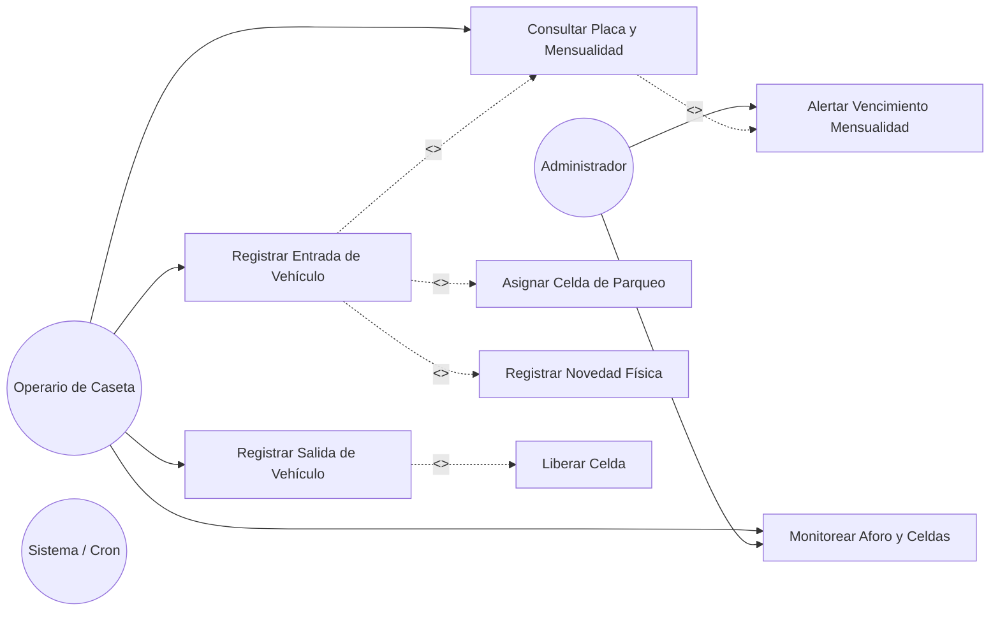
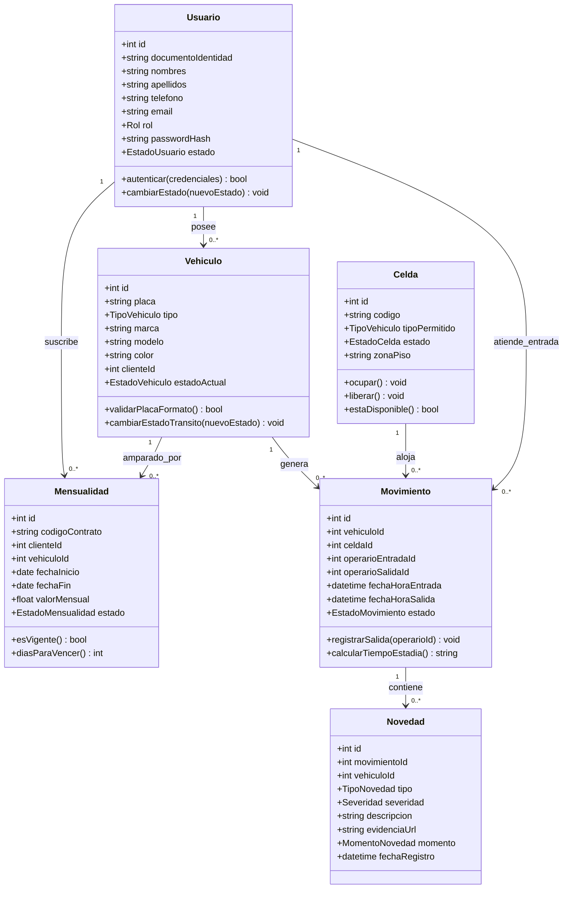
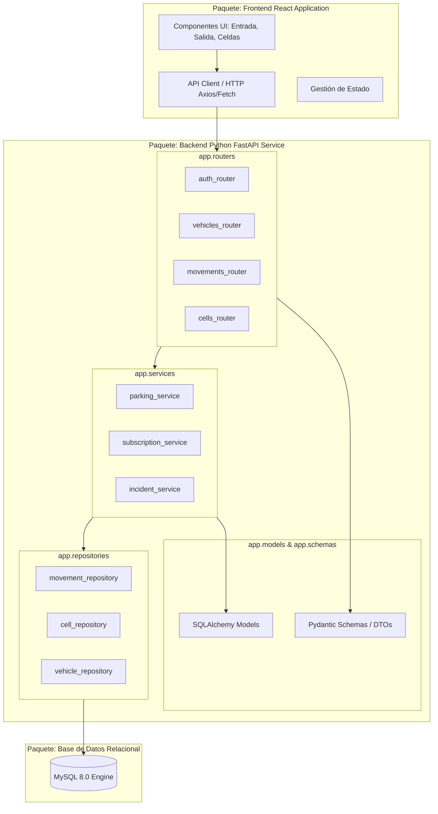

# Diseño de Arquitectura y Diagramas UML
## Proyecto: Parqueadero Autos Colombia - Iteración 1

Este documento define la arquitectura general del sistema y proporciona las especificaciones para los diagramas UML requeridos (Casos de Uso, Diagrama de Clases y Diagrama de Paquetes), acompañados de sus representaciones gráficas en Mermaid y la guía paso a paso para su modelado en la herramienta **StarUML**.

---

## 1. Especificación de la Arquitectura del Sistema

El sistema implementa una **Arquitectura en Capas (Layered / Clean Architecture adaptada)**, desacoplando la interfaz de usuario del backend mediante servicios REST y aislando la persistencia de datos:

```
┌────────────────────────────────────────────────────────┐
│             CAPA DE PRESENTACIÓN (FRONTEND)            │
│   React + Vite SPA | Hooks de Estado | CSS Moderno     │
└───────────────────────────┬────────────────────────────┘
                            │ JSON / HTTP REST API
┌───────────────────────────▼────────────────────────────┐
│              CAPA DE CONTROLADORES (ROUTERS)           │
│   FastAPI APIRouters | Validación Pydantic Schemas     │
├────────────────────────────────────────────────────────┤
│              CAPA DE SERVICIOS (LÓGICA DE NEGOCIO)     │
│   Validación de Mensualidad | Anti-passback | Reglas    │
├────────────────────────────────────────────────────────┤
│              CAPA DE REPOSITORIOS / PERSISTENCIA       │
│   SQLAlchemy 2.0 ORM | Transacciones ACID | Sesiones    │
└───────────────────────────┬────────────────────────────┘
                            │ Conexión TCP / PyMySQL
┌───────────────────────────▼────────────────────────────┐
│             CAPA DE BASE DE DATOS (MOTOR RELACIONAL)   │
│   MySQL 8.x (InnoDB, Constraints, Triggers/Índices)    │
└────────────────────────────────────────────────────────┘
```

---

## 2. Diagrama de Casos de Uso (UML)

### 2.1. Representación en Mermaid


### 2.2. Guía para Modelar en StarUML:
1. Abrir **StarUML** -> Menú `Model` -> `Add Diagram` -> `Use Case Diagram`.
2. Desde la barra de herramientas lateral (*Toolbox*), arrastrar 2 actores (`Actor`):
   - **Operario de Caseta**
   - **Administrador**
3. Arrastrar los casos de uso (`UseCase`) y nombrarlos:
   - `CU-01: Validar Placa y Mensualidad`
   - `CU-02: Registrar Entrada de Vehículo`
   - `CU-03: Asignar Celda`
   - `CU-04: Registrar Novedad Física`
   - `CU-05: Registrar Salida de Vehículo`
   - `CU-06: Liberar Celda de Parqueo`
   - `CU-07: Monitorear Tablero de Celdas`
4. Crear relaciones:
   - `Association` desde los actores hacia los Casos de Uso correspondientes.
   - `Include` desde `Registrar Entrada` hacia `Validar Placa` y hacia `Asignar Celda`.
   - `Extend` desde `Registrar Novedad` hacia `Registrar Entrada` (condición: daño visible).
   - `Include` desde `Registrar Salida` hacia `Liberar Celda`.

---

## 3. Diagrama de Clases del Dominio (UML)

### 3.1. Representación en Mermaid


### 3.2. Guía para Modelar en StarUML:
1. Menú `Model` -> `Add Diagram` -> `Class Diagram`.
2. Arrastrar elementos `Class` desde el Toolbox para cada entidad:
   - `Usuario`, `Vehiculo`, `Celda`, `Mensualidad`, `Movimiento`, `Novedad`.
3. Para cada clase, hacer clic derecho -> `Add Attribute` para agregar los campos con visibilidad (`+` Public, `-` Private) y tipo de dato.
4. Clic derecho -> `Add Operation` para agregar los métodos de dominio (ej. `esVigente()`, `ocupar()`, `liberar()`).
5. Dibujar asociaciones `Directed Association` o `Association` configurando las multiplicidades (`1` a `0..*`).

---

## 4. Diagrama de Paquetes (UML)

Organiza los módulos lógicos del sistema y define sus dependencias e interfaces:

### 4.1. Representación en Mermaid


### 4.2. Guía para Modelar en StarUML:
1. Menú `Model` -> `Add Diagram` -> `Package Diagram`.
2. Arrastrar elementos `Package` (`app.routers`, `app.services`, `app.repositories`, `app.models`, `Frontend_App`, `MySQL_DB`).
3. Crear relaciones de dependencia (`Dependency` - flecha punteada) indicando el flujo unidireccional de capas, respetando el principio de inversión de dependencias.
