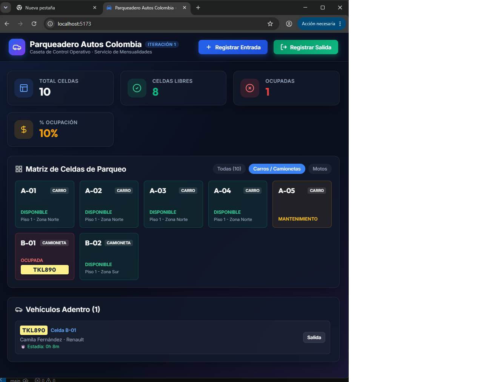
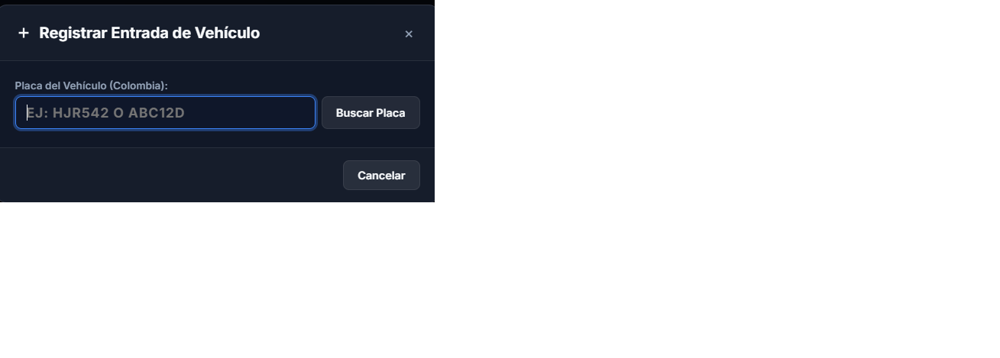
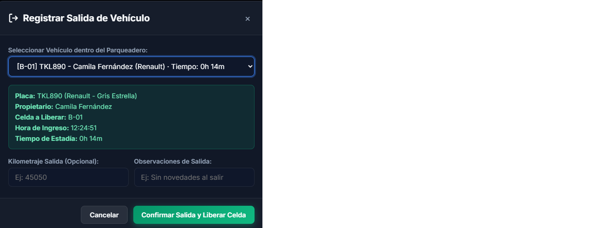

# Mockups y Especificación de Interfaz de Usuario (UI/UX)
## Proyecto: Parqueadero Autos Colombia - Iteración 1

Este documento especifica la arquitectura de información, la guía de diseño visual y los wireframes estructurales para las pantallas principales de la **Iteración 1: Gestión de entrada y salida de vehículos y monitoreo de celdas**.

---

## 1. Guía de Estilos y Design Tokens

- **Tipografía:** `Inter`, `system-ui`, `-apple-system`, sans-serif (para máxima legibilidad en monitores de caseta).
- **Paleta de Colores (Theme Dark / Modern Pro):**
  - Fondo Principal (`Background`): `#0F172A` (Slate 900 oscuro profundo)
  - Superficies y Tarjetas (`Surface`): `#1E293B` (Slate 800 con bordes sutiles `#334155`)
  - Acento Primario (`Primary`): `#3B82F6` (Azul eléctrico moderno) / `#2563EB`
  - Acento Éxito (`Success` - Celda Libre / Mensualidad Al Día): `#10B981` (Verde Esmeralda)
  - Acento Peligro (`Danger` - Celda Ocupada / Vencida): `#EF4444` (Rojo Carmesí)
  - Acento Advertencia (`Warning` - Mantenimiento / Próximo a vencer): `#F59E0B` (Ámbar)
  - Texto Principal (`Text Primary`): `#F8FAFC` (Blanco suave)
  - Texto Secundario (`Text Muted`): `#94A3B8` (Gris frío)

---

## 2. Wireframes de Pantallas Principales

### Pantalla 1: Registro de Entrada de Vehículos (Caseta)
Optimizada para digitación ágil mediante teclado (`Tab` y `Enter`).

```
+----------------------------------------------------------------------------------------------------+
|  PARQUEADERO AUTOS COLOMBIA   [ Monitor de Celdas ]  [ Entradas ]  [ Salidas ]     Operario: Andrés|
+----------------------------------------------------------------------------------------------------+
|                                                                                                    |
|  REGISTRO DE ENTRADA                                               ESTADO DE AFORO EN VIVO         |
|  =============================================================     =============================   |
|  1. Consultar Placa:                                               Total Celdas: 10                |
|  +---------------------------+  [ BUSCAR (Enter) ]                 Libres Carros: 4                |
|  | HJR542                    |                                     Libres Motos:  2                |
|  +---------------------------+                                     Ocupadas:      3                |
|                                                                    Ocupación:     30%              |
|  DATOS DEL CLIENTE Y MENSUALIDAD                                                                   |
|  +---------------------------------------------------------------+                                 |
|  | Propietario: Mauricio Restrepo      | Tipo: AUTOMÓVIL         |                                 |
|  | Vehículo:    Mazda 3 Rojo Diamante  | Tel:  3201122334        |                                 |
|  | Contrato:    CTR-2026-001           | Vence: 2026-11-01       |                                 |
|  | ESTADO:      [ VIGENTE - AL DÍA ]   (Vence en 19 días)        |                                 |
|  +---------------------------------------------------------------+                                 |
|                                                                                                    |
|  2. Asignación de Celda de Parqueo:                                                                |
|     Celda Sugerida: [ Celda A-01 (Zona Norte - Libre)  v ]                                         |
|                                                                                                    |
|  3. Novedades al Ingreso (Opcional):                                                               |
|     [x] Registrar Novedad Física en Vehículo                                                       |
|     +--------------------------------------------------------------------------------------------+ |
|     | Tipo: [ Rayón / Carrocería v ]     Severidad: [ Moderado v ]                               | |
|     | Descripción: [ Rayón superficial de 10cm en puerta delantera derecha                     ] | |
|     +--------------------------------------------------------------------------------------------+ |
|                                                                                                    |
|     [ CONFIRMAR ENTRADA E IMPRIMIR TICKET (F9) ]            [ CANCELAR (Esc) ]                    |
|                                                                                                    |
+----------------------------------------------------------------------------------------------------+
```

---

### Pantalla 2: Registro de Salida de Vehículos
Permite búsqueda por placa y muestra el cálculo automático del tiempo de permanencia.

```
+----------------------------------------------------------------------------------------------------+
|  REGISTRO DE SALIDA DE VEHÍCULO                                                                    |
|  ================================================================================================= |
|  Buscar Vehículo Dentro del Parqueadero:                                                           |
|  Placa o Celda: [ HJR542                     ]   [ VERIFICAR SALIDA ]                              |
|                                                                                                    |
|  +-----------------------------------------------------------------------------------------------+ |
|  | Vehículo:          HJR542 - Mazda 3 2021 (Rojo Diamante)                                      | |
|  | Cliente:           Mauricio Restrepo (Contrato CTR-2026-001 - VIGENTE)                        | |
|  | Celda Asignada:    A-01 (Piso 1 - Zona Norte)                                                 | |
|  | Hora de Entrada:   13-Oct-2026 08:15 AM                                                       | |
|  | Hora de Salida:    13-Oct-2026 05:45 PM                                                       | |
|  | TIEMPO ESTADÍA:    09 horas, 30 minutos                                                       | |
|  | Novedades Entrada: Rayón superficial de 10cm en puerta delantera derecha                      | |
|  | Cobro Excedente:   $ 0.00 COP (Cubierto por Mensualidad Activa)                               | |
|  +-----------------------------------------------------------------------------------------------+ |
|                                                                                                    |
|     [ CONFIRMAR SALIDA Y LIBERAR CELDA A-01 ]               [ VOLVER ]                             |
+----------------------------------------------------------------------------------------------------+
```

---

### Pantalla 3: Matriz Visual de Celdas y Aforo (Dashboard en Vivo)
Permite monitorear el estado físico de los puestos de estacionamiento en tiempo real con tarjetas interactivas.

```
+----------------------------------------------------------------------------------------------------+
|  MONITOR DE CELDAS EN TIEMPO REAL              Filtro: [ Todos v ]  [ Solo Carros ]  [ Solo Motos ]|
|  ================================================================================================= |
|  MÉTRICAS:  [ TOTAL: 10 ]   [ LIBRES: 6 ]   [ OCUPADAS: 3 ]   [ MANTENIMIENTO: 1 ]                 |
|                                                                                                    |
|  ZONA NORTE (CARROS):                                                                              |
|  +---------------+  +---------------+  +---------------+  +---------------+  +---------------+     |
|  | Celda: A-01   |  | Celda: A-02   |  | Celda: A-03   |  | Celda: A-04   |  | Celda: A-05   |     |
|  | [ OCUPADA ]   |  | [ LIBRE ]     |  | [ LIBRE ]     |  | [ LIBRE ]     |  | [MANTENIMIENTO|     |
|  | Placa: HJR542 |  | Tipo: Carro   |  | Tipo: Carro   |  | Tipo: Carro   |  | En reparación |     |
|  | 09h 30m       |  |               |  |               |  |               |  |               |     |
|  +---------------+  +---------------+  +---------------+  +---------------+  +---------------+     |
|                                                                                                    |
|  ZONA SUR (CAMIONETAS / ESPECIALES):                                                               |
|  +---------------+  +---------------+  +---------------+                                           |
|  | Celda: B-01   |  | Celda: B-02   |  | Celda: E-01   |                                           |
|  | [ LIBRE ]     |  | [ LIBRE ]     |  | [ LIBRE ]     |                                           |
|  | Tipo: Camion  |  | Tipo: Camion  |  | Discapacitado |                                           |
|  +---------------+  +---------------+  +---------------+                                           |
|                                                                                                    |
|  ZONA MOTOS:                                                                                       |
|  +---------------+  +---------------+                                                              |
|  | Celda: M-01   |  | Celda: M-02   |                                                              |
|  | [ OCUPADA ]   |  | [ LIBRE ]     |                                                              |
|  | Placa: WXY12C |  | Tipo: Moto    |                                                              |
|  +---------------+  +---------------+                                                              |
```

---

## 3. Capturas Reales del Sistema en Ejecución

A continuación se presentan las capturas obtenidas directamente durante la validación operativa en el navegador:

### 3.1. Dashboard Principal y Matriz de Celdas en Tiempo Real


### 3.2. Formulario de Entrada - Búsqueda por Placa


### 3.3. Formulario de Entrada - Vehículo Validado y Celda Asignada


### 3.4. Formulario de Salida - Selección de Vehículo


### 3.5. Formulario de Salida - Resumen de Estadía y Liberación


